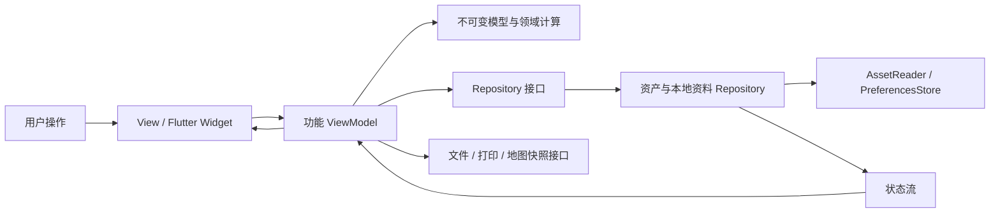

# 前端架构

应用采用按功能组织的 MVVM。Android、iOS、Web 共用 `lib/` 下的业务模型、状态和页面，平台差异通过 Service 接口注入。旧 HTML/React 页面不参与运行，也没有 WebView 包装层。

## 职责

- `app/` 是组合根，负责依赖注入、路由和自适应导航。主题变量与通用控件位于 `core/ui/`；core 不导入 app 或业务功能。页面不创建平台插件实例。
- 跨功能通过 `BookSession`、`BudgetSummary`、`PreparationProgress`、`PreferencesStatus` 和 `ExportActions` 等窄接口协作。旅行册图片、来源链接等业务组件由 books 的公开入口提供，备份对话框属于 export。功能不得直接导入其他功能的 data/presentation 实现。
- `features/books/domain/` 保存旅行册、行程版本、稳定日期 ID、住宿、参考来源等不可变模型。
- `features/books/data/` 读取随包资产并缓存解析结果；数据失败可重试，不把异常解释为空行程。
- `features/preferences/` 管理设备资料。Repository 是备注、清单、方案和预算的唯一持久化来源，写入按顺序提交。读取异常或格式损坏时暂停自动写回，保留原始存储和会话内编辑；有效导入成功后才解除保护。保存失败保留会话内数据并显示状态。导入先验证再提交，与同时发生的编辑串行处理；成功替换资料会发布独立的 replacementRevision，使预算草稿更新到导入值，普通保存通知不会清除正在编辑的草稿。
- `features/budget/domain/` 和 `features/energy/domain/` 是纯 Dart 计算，不依赖 Widget 或平台存储。赣皖预算、返程差额和西藏暂计沿用旧版规则，未知里程/价格保留未知。
- `features/map/domain/` 处理 WGS84 几何、日期筛选、别名和缺失路段；`presentation/` 使用 CustomPainter。相同版本和日期复用投影结果，拖动缩放不重新解析道路数据。
- 行程、预算、清单、风险、景点各有独立 ViewModel；`BookViewModel` 只协调旅行册与方案，不承担所有页面状态。
- 文件选择、保存分享、打印、PDF 和 PNG 快照都有接口。导出只消费不可变的 TravelReport/RouteMapSnapshot；组合根提供快照读取函数，导出 ViewModel 不持有其他功能的 ViewModel。并发地图读取等待同一个任务，完整 PDF 遇到地图读取失败时明确报错，可重试。Web 保存直接下载文件，移动端交给系统分享面板；平台差异封装在 Service 中。原生插件在组合根注入，单测用替身验证控制流程，真实导出和浏览器交互另行验收。

## 数据迁移

`tools/export-legacy.mjs` 从固定 Git 提交读取旧源码，在开发时将两套路书整理为版本化 JSON。发布的应用仅解析数据，不执行旧 JavaScript。提交记录通过归档分支与合并父节点保留。

资产中包含赣皖 3 个版本、西藏 30 个组合、12 处景点、48 项西藏清单与 14 项风险。原有道路缓存、来源日期、照片作者与授权一起保存。`pnpm verify:assets` 检查生成数据和图片是否仍与固定快照一致。

用户资料采用独立 schema，不与旅行册数据混存。备注/清单按稳定 ID 保存，15/16/17 天重新编号不改变归属；住宿和门票金额可以按方案保存。预算重置不影响备注或清单。

Web 首次启动兼容 `cinna-ganwan-v1`、`tibet-checklist-personal-v2` 和旧 `tibet-checklist`。保留原键；Android/iOS 和不同设备通过 JSON 备份迁移。文件选择、导入与导出共用 16 MiB 备份上限；超限导出会报错，不生成应用自身无法导入的文件。导入还会验证 schema、文本长度和数值类型；不支持的文件不覆盖现有资料。

## 路由与资源

- `/` 为旅行册目录；`/book/:bookId/:section` 为功能页面，`?day=` 表示稳定日期 ID。
- 地图日期由 URL 恢复；切换日期、显示全部、同页参数变化和返回旧链接都重新应用对应筛选。异步导出使用操作开始时的日期/方案快照。
- Web 使用 hash 路由兼容 GitHub Pages 子路径；原西藏入口迁至新站的 `tibet/` 并重定向到对应 Flutter 页面。
- 小屏使用底部导航与完整目录，大屏使用侧边目录。布局不负责预算或数据筛选。
- 中文字体、图片、道路、PDF.js 均随包部署；Web 使用本应用范围的版本缓存，不清除个人 localStorage 或其他网站缓存。

## 验证

36 组旧 JavaScript 预算结果是迁移的对照数据，覆盖所有西藏组合及赣皖默认/多人参数。测试同时覆盖未知值、返程天数、重复收费、状态隔离、损坏存储、导入失败、真实 PNG/PDF 生成、路由、备注编辑、预算重置和手机大字号布局。

三端 CI 使用锁定依赖与 Flutter 3.47.7。`pnpm check:boundaries` 检查 core 的依赖方向、跨功能公开入口和领域层依赖；与 format、analyze、unit/widget 测试及资源一致性一起执行。

push 只修改 README、AGENTS 或 docs 时不启动三端构建，也不会取消正在进行的应用验收。PR 和手动触发仍执行完整检查；应用、资产、依赖和工作流变更仍触发三端构建及验证后的发布。

Android 同时生成开发包和未签名 Release 包；iOS 生成模拟器和未签名设备构建，Web 生成生产构建。Android Release 没有 debug 签名回退；本地存在完整的 `android/key.properties` 时才使用专用 release 签名，文件格式见 `android/key.properties.example`。签名材料不进入仓库或 CI 缓存。模拟器构建、单测和浏览器检查不能代替真机文件分享、系统打印或正式签名/上架验收。

固定版本的 Flutter 在 Android 的 `--no-pub` 构建中会跳过按构建模式生成插件注册文件，见官方 [#169336](https://github.com/flutter/flutter/issues/169336)。CI 先执行 `flutter pub get --enforce-lockfile`，随后使用普通的 `flutter build apk --release` / `--debug` 切换注册内容；每次构建后检查 `pubspec.lock` 完全未变。这样生产包不引用 integration_test，模拟器测试仍能注册开发插件。

参考：[Flutter 架构建议](https://docs.flutter.dev/app-architecture/recommendations)、[架构指南](https://docs.flutter.dev/app-architecture/guide)、[自适应布局](https://docs.flutter.dev/ui/adaptive-responsive)。

原生 smoke test 使用真实资产、SharedPreferences 平台插件和 Canvas 渲染。只有明确传入 `NATIVE_TEST_DISPOSABLE=true` 才会执行，且会在结束时恢复测试前的资料；不能在个人常用设备上运行。

iOS CI 给固定版本的主机工具补入 Flutter 官方 [#193142](https://github.com/flutter/flutter/pull/193142) 对模拟器日志启动竞态的修复，避免编译后漏读 VM Service 地址而挂起。补丁固定上游提交和文件校验和，只允许在一次性 macOS CI 主机应用；Flutter 运行库仍为 3.47.7。SDK 升级时需复核并移除已包含的临时回补。
